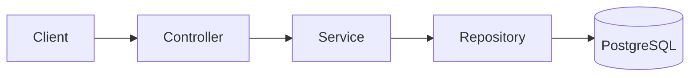

# NEXORA

[](https://github.com/ByCmG10/nexora/actions/workflows/ci.yml)

NEXORA is a REST API for managing a product inventory, built as a backend portfolio project with Java 21, Spring Boot
and PostgreSQL. It is a single-service API with one entity (`Product`); the focus is on clean layering, a
reproducible database, careful query behaviour and a test suite that also runs against a real PostgreSQL.

## Features

- Create products identified by SKU. SKUs are trimmed and stored upper-case, so they are case-insensitive and unique
  (enforced by the service and by a database constraint).
- Look up a product by exact SKU, search by partial SKU or by name.
- Update stock or price of a product; delete a product.
- Query by stock (exact, minimum, maximum), by price (maximum, range), low stock (stock at or below the product's
  minimum stock) and out of stock.
- **Combinable dynamic filter** (`/api/products/filter-optional`): name, price range and stock range in any
  combination, with database-side pagination and sorting by price or stock (ties broken by id so pages are stable).
- Bean Validation on request bodies and parameters.
- Errors as RFC 9457 `ProblemDetail` responses (400 validation / malformed input, 404, 409 duplicate SKU, and a
  generic 500 that never exposes internals).
- HTTP Basic authentication for the API.
- OpenAPI specification and Swagger UI.

## Tech stack

Java 21, Spring Boot 4.1, Spring Web (MVC), Spring Data JPA / Hibernate, PostgreSQL 18, Flyway, Spring Security,
springdoc-openapi, Maven (wrapper included), Docker / Docker Compose, JUnit 5, MockMvc, H2 (fast test suite),
Testcontainers (real PostgreSQL).

## Architecture



- `ProductController` handles HTTP and maps results to `ProductResponse`.
- `ProductService` holds the rules (SKU normalisation, duplicate check, range validation, the dynamic filter).
- `ProductRepository` is a Spring Data repository.
- `Product` is the internal JPA entity and is never serialised to clients; `ProductResponse` is the output DTO and the
  boundary of the HTTP API.
- `ProductExceptionHandler` (`@RestControllerAdvice`) centralises error responses as `ProblemDetail`.
- Flyway owns the schema; Hibernate runs with `ddl-auto=validate` and only checks that the entities match it.

## Database migrations

Migrations live in `src/main/resources/db/migration` and run automatically at startup. `V1__create_products_table.sql`
creates the `products` table (identity primary key, `NUMERIC(12,2)` price, non-negative stock checks and a unique
constraint on `sku`). Flyway records applied migrations in `flyway_schema_history`; a schema change means adding a new
`V<n>__description.sql` file, never editing an applied one.

## Testing

- The fast suite (MockMvc, repository and service behaviour) runs on an in-memory H2 database in PostgreSQL mode, using
  the same Flyway migrations.
- `ProductPostgresIntegrationTests` starts a throwaway PostgreSQL with Testcontainers and checks, on a real database,
  the Flyway migration, the unique SKU constraint, a combined filter and sorting with stable tie-breaking. It requires
  Docker and does not use any local database.
- Run everything with `./mvnw clean verify` (`mvnw.cmd` on Windows). CI is the source of truth for the current result.

## Running locally

Requirements: JDK 21 and Docker. The Maven wrapper downloads Maven.

NEXORA reads its configuration from **environment variables** (see `src/main/resources/application.properties`).
Spring Boot does **not** load `.env` automatically; only Docker Compose does. So `.env` configures the database
container, and you export the same values for the application.

1. Create your env file and edit the values (`.env` is git-ignored):

   ```bash
   cp .env.example .env
   ```

   | Variable | Used by | Meaning |
   | --- | --- | --- |
   | `DB_NAME`, `DB_PORT` | Compose | database name and host port (defaults `nexora`, `5432`) |
   | `DB_USERNAME`, `DB_PASSWORD` | Compose and app | database credentials |
   | `DB_URL` | app | JDBC URL, must match `DB_PORT` / `DB_NAME` |
   | `NEXORA_DEV_PASSWORD` | app | password of the HTTP Basic user |

   If something else already uses port 5432, change `DB_PORT` and the port in `DB_URL`.

2. Start PostgreSQL and wait until it is healthy:

   ```bash
   docker compose up -d --wait
   ```

3. Export the variables and run the application.

   Linux / macOS / Git Bash:

   ```bash
   set -a; source .env; set +a
   ./mvnw spring-boot:run
   ```

   Windows PowerShell:

   ```powershell
   Get-Content .env | Where-Object { $_ -match '^\s*[^#\s][^=]*=' } | ForEach-Object {
     $name, $value = $_ -split '=', 2
     Set-Item -Path "Env:$($name.Trim())" -Value $value.Trim()
   }
   .\mvnw.cmd spring-boot:run
   ```

   Flyway creates the schema on first start. The API listens on `http://localhost:8080`.

Alternatively, point `DB_URL`, `DB_USERNAME` and `DB_PASSWORD` at any PostgreSQL you already run (the database must
exist and the user must be able to create tables). Stop the container with `docker compose down` (add `-v` to also
delete the data).

## API authentication

All `/api/**` endpoints use HTTP Basic. The user is `nexora_dev` and its password is the value of
`NEXORA_DEV_PASSWORD`. This is a single configured development user, not a user database. The OpenAPI document and
Swagger UI are public; the API is not.

## API documentation

- Swagger UI: <http://localhost:8080/swagger-ui.html> (use *Authorize* with the Basic credentials to try requests)
- OpenAPI JSON: <http://localhost:8080/v3/api-docs>

## Main endpoints

| Method | Path | Purpose |
| --- | --- | --- |
| `POST` | `/api/products` | Create a product (`201`, `409` if the SKU exists) |
| `GET` | `/api/products/sku/{sku}` | Get a product by exact SKU |
| `PUT` | `/api/products/sku/{sku}/stock` | Update stock |
| `PUT` | `/api/products/sku/{sku}/price` | Update price |
| `DELETE` | `/api/products/sku/{sku}` | Delete a product |
| `GET` | `/api/products/filter-optional` | **Recommended general search**: optional `name`, `minPrice`, `maxPrice`, `minStock`, `maxStock`, plus `page`, `size`, `sortBy` (`price`/`stock`), `direction` (`asc`/`desc`) |
| `GET` | `/api/products/search-by-sku?sku=` | Partial SKU search |
| `GET` | `/api/products/low-stock` | Stock at or below the product's minimum stock |
| `GET` | `/api/products/out-of-stock` | Stock equal to 0 |

The API also keeps several fixed-purpose query endpoints (`by-stock`, `by-max-price`, `search`, `filter`, ...). They
are kept for compatibility; `filter-optional` covers the general case.

## Example requests

```bash
# Create a product
curl -u nexora_dev:<your-password> -H "Content-Type: application/json" \
  -d '{"name":"T-shirt","sku":"TS-001","price":19.90,"stock":25,"minimumStock":5}' \
  http://localhost:8080/api/products

# Products whose name contains "shirt", cheapest first, 10 per page
curl -u nexora_dev:<your-password> \
  "http://localhost:8080/api/products/filter-optional?name=shirt&sortBy=price&direction=asc&size=10"
```

## CI

GitHub Actions (`.github/workflows/ci.yml`) builds and runs the whole test suite with the Maven wrapper on every push
and pull request to `main`. The PostgreSQL integration tests use the Docker daemon of the GitHub-hosted runner; no
secrets are required.

## Project status

Portfolio backend, version 1. It is not deployed anywhere. Not implemented (possible future work): token-based
authentication (JWT) and roles, a frontend, additional entities.
